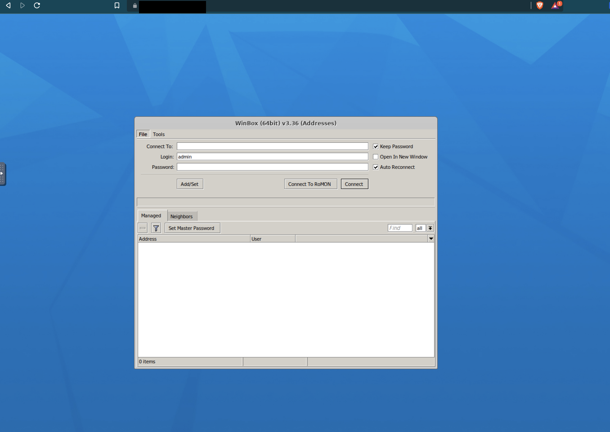
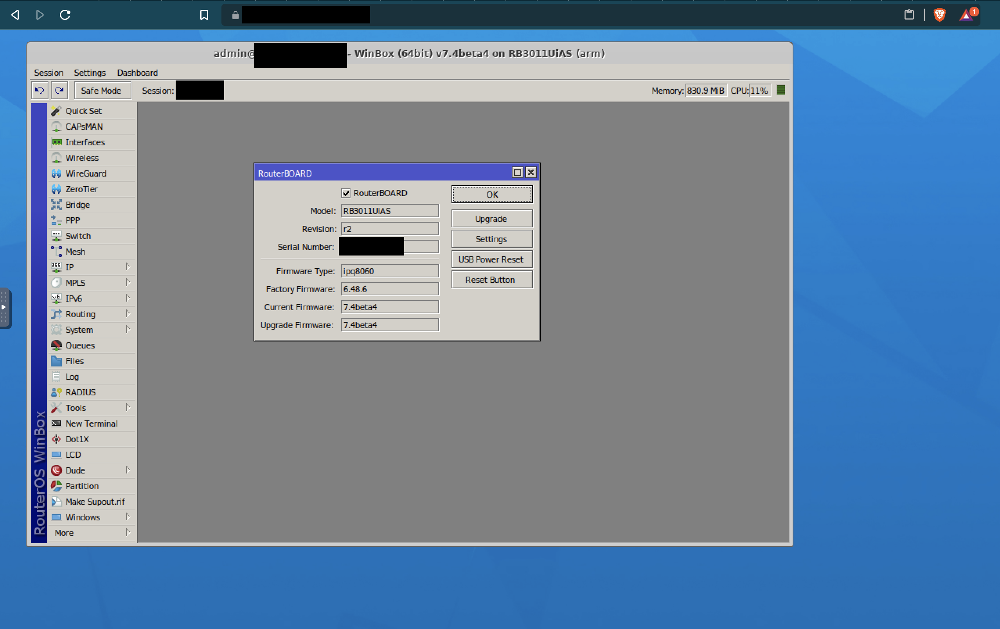

# Winbox in docker

> **This project is archived and no longer maintained.**
>
> Archived in September 2026. The last release is v3.40.0 (August 2023) and
> nothing has been rebuilt since: the published images
> (`ghcr.io/obeone/winbox`, `docker.io/obeoneorg/winbox`) are already old,
> built on Ubuntu 20.04 with the Wine, KasmVNC and Winbox versions of that
> time, and have received no security updates since then. They stay available
> for reference only. Run them at your own risk, or better, not at all.
>
> MikroTik now ships WinBox 4 natively for Linux and macOS, which removes most
> of the reason this project existed. Get it from the
> [MikroTik download page](https://mikrotik.com/download).
>
> The Helm chart in [obeone/charts](https://github.com/obeone/charts) is
> deprecated as well. Issues and pull requests are no longer handled.


 [](https://artifacthub.io/packages/search?repo=obeone)

Use Mikrotik's Winbox with your browser !

Using [KasmVNC](https://github.com/kasmtech/KasmVNC), this docker starts Winbox with Wine and make it avaiable in any browser.

## Screenshots




## Usage
### Docker
```sh
docker run -d --shm-size=512m -p 6901:6901 -e VNC_PW=password -v winbox_wine:/home/kasm-user/.wine ghcr.io/obeone/winbox:latest
```

You can access it at the address https://localhost:6901 with user `kasm_user` and password `password`.

It's not mandatory to mount (or bind) the volume, but it save initial configuration of Wine (which can take a while) and your winbox sessions.

#### TLS
If you want to use your own certificate rather than the autogenerated one, you can mount a PEM to the path `/config/private-cert.pem` :

```sh
docker run -d --shm-size=512m -p 6901:6901 -e VNC_PW=password -v winbox_wine:/home/kasm-default-profile/.wine -v LOCAL_PEM_PATH:/config/private-cert.pem:ro ghcr.io/obeone/winbox:latest
```

### Kubernetes (Helm)
A helm chart exists, just follow
[documentation](https://github.com/obeone/charts)
